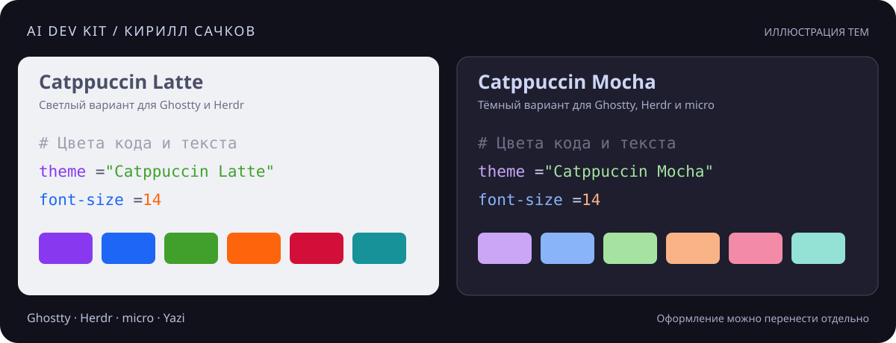

# AI Dev Kit · Кирилл Сачков

Мой набор для разработки с AI. Здесь собраны инструменты, полезные скиллы, источники и мои конфиги. Выбирай то, что подходит под твою задачу, или разбирайся вместе со своим агентом.

[YouTube](https://www.youtube.com/@SachkovDev) · [Telegram](https://t.me/sachkov_blog) · [GitHub](https://github.com/KirillSachkov)



*Иллюстрация тем Catppuccin Latte и Mocha. Ghostty и Herdr переключают светлый и тёмный варианты; micro использует Mocha.*

| Раздел | Что найдёшь |
|---|---|
| [Инструменты](TOOLS.md) | Мой текущий стек и выбранные дополнения |
| [Полезные скиллы](skills/README.md#полезные-скиллы) | Pipeline Matt Pocock и подключение из оригинального репозитория |
| [Источники](sources/README.md) | Документация, темы и историческая подборка к видео |
| [Мои конфиги](configs/README.md) | Ghostty, Herdr, micro и Yazi |

## Инструменты

Работаю на macOS. Ghostty открывает терминал, Herdr собирает сессии и панели, Codex и Claude Code работают с кодом. По умолчанию редактирую файлы в micro, а открываю папки через Yazi. В моём наборе также есть Neovim, VS Code, Obsidian и Zen.

Orca и CanvasTTY находятся в [выбранных дополнениях](TOOLS.md#выбранные-дополнения). Если твой редактор или терминал уже устраивает, оставь его.

## Разобраться вместе с агентом

Скачай ZIP через кнопку Code или клонируй набор:

```bash
git clone https://github.com/KirillSachkov/ai-dev-kit.git
```

Открой папку в агенте и отправь запрос:

```text
Используй скилл sachkov-ai-kit из skills/sachkov-ai-kit/SKILL.md.
Помоги разобраться в наборе Кирилла Сачкова под мои задачи.
У меня macOS и VS Code. Хочу выбрать оформление терминала
и понять, нужен ли мне Herdr.
```

Два [скилла набора](skills/README.md#скиллы-этого-набора) помогают выбрать материалы и настроить выбранный компонент. В Codex и Claude Code они доступны из папки проекта. Их можно [установить отдельно](skills/README.md#установка-скиллов-набора).

## Мои конфиги

В [конфигах](configs/README.md) лежат темы, шрифты, клавиши и обычные настройки четырёх инструментов. Снимок сверён 6 октября 2026 года. Настройка идёт по одному компоненту с сохранением твоих файлов. Можно закончить после одной темы.
